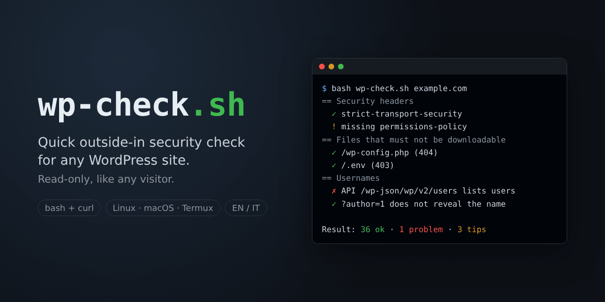
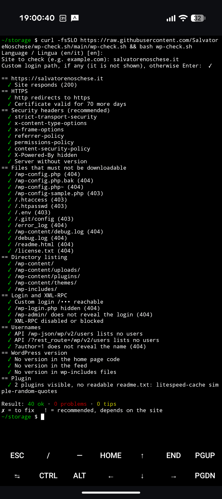

# wp-check

A quick, outside-in security check of a WordPress site, in one bash script.
It runs anywhere bash and curl do — Linux, macOS, even your phone with [Termux](https://termux.dev/) — and answers in English or Italian.

```bash
curl -fsSLO https://raw.githubusercontent.com/SalvatoreNoschese/wp-check.sh/main/wp-check.sh && bash wp-check.sh
```

## What it checks

- **HTTPS**: http redirects to https, certificate expiry
- **Security headers**: HSTS, X-Content-Type-Options, X-Frame-Options, Referrer-Policy, Permissions-Policy, Content-Security-Policy; whether `Server` or `X-Powered-By` reveal software and versions
- **Files that must not be downloadable**: `wp-config.php` and its backups, `.htaccess`, `.htpasswd`, `.env`, `.git`, logs, `readme.html`, `license.txt`
- **Directory listing** in the WordPress folders
- **Login**: your custom login path (if any) works, and `wp-login.php` and `/wp-admin/` don't give it away
- **XML-RPC**: enabled or not, with or without pingback
- **Usernames**: exposed by the REST API (`/wp-json/wp/v2/users`) or by `?author=1`
- **WordPress version**: in the home page, the feed, the `wp-includes` files
- **Plugins**: those visible from the home page, and whether their `readme.txt` (which usually states the version) is readable

Results: **✓** fine · **✗** to fix · **!** recommended, depends on the site.

## What it does not do

It is not a vulnerability scanner. It only sends read-only requests, the same a normal visitor would: no login attempts, no passwords, no attacks. Use it on your own sites, or on sites you are allowed to test.

Your custom login path is never shown — not while you type it, not in the results — so screenshots are safe to share.

## Usage

```bash
bash wp-check.sh                       # asks language, site and custom login path
bash wp-check.sh --en example.com      # language and site from the command line
bash wp-check.sh --it esempio.it
```



Requirements: bash, curl and the usual core tools (checked at start). `openssl` is optional, for the certificate expiry.
On Termux: `pkg install curl openssl-tool`.

The exit code is `0` when there are no problems, so it can run from cron and mail you the result.

## Italiano

Controllo rapido della sicurezza di un sito WordPress, visto da fuori. Funziona ovunque ci siano bash e curl, anche dal telefono con Termux, e risponde in italiano o in inglese. Fa solo richieste in lettura, come un visitatore qualsiasi: usalo sui tuoi siti. L'indirizzo di login personalizzato non viene mai mostrato. Articolo con i dettagli: [salvatorenoschese.it/wp-check***](https://salvatorenoschese.it/wp-check-sh-controlla-la-sicurezza-del-tuo-wordpress/).

## License

GPLv3 — © Salvatore Noschese · [salvatorenoschese.it](https://salvatorenoschese.it/)
