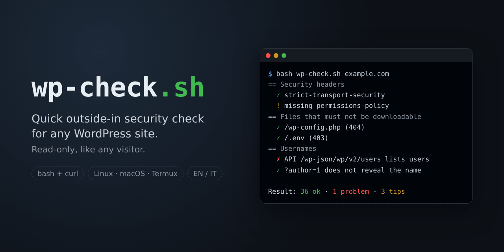
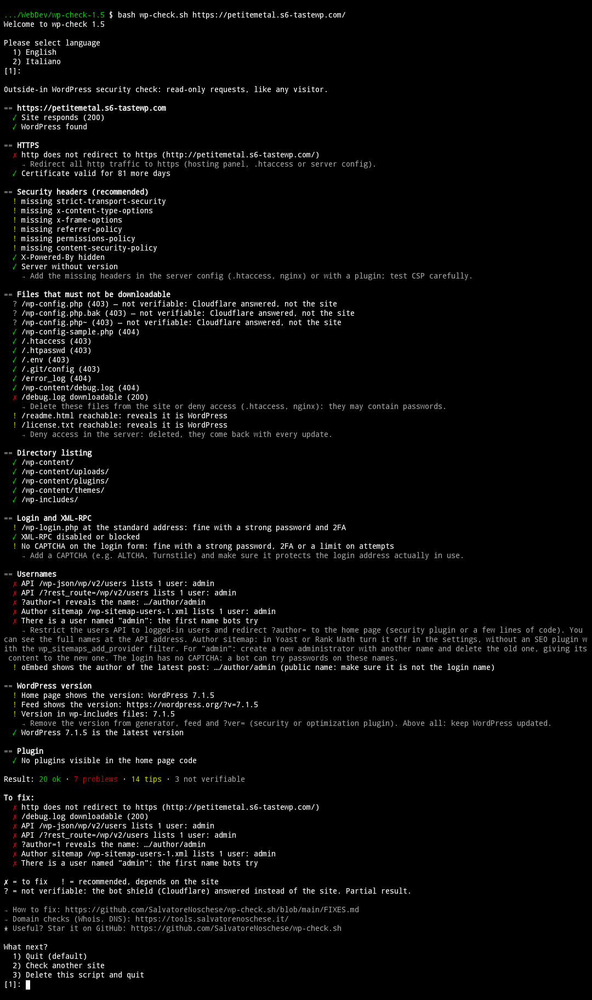
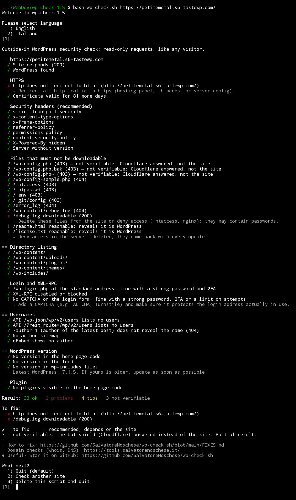
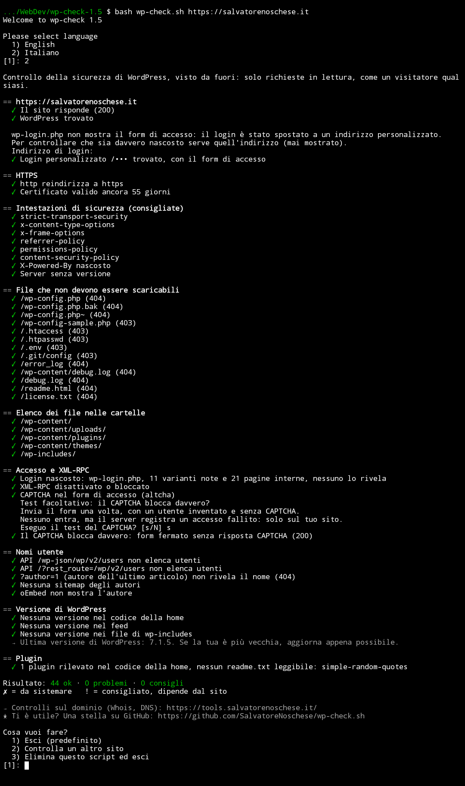

# wp-check

  

A quick, outside-in security check of a WordPress site, in one bash script.
It runs anywhere bash and curl do — Linux, macOS, even your phone with [Termux](https://termux.dev/) — and answers in English or Italian.

```bash
curl -fsSLO https://raw.githubusercontent.com/SalvatoreNoschese/wp-check.sh/main/wp-check.sh && bash wp-check.sh
```

## What it checks

- **HTTPS**: http redirects to https, certificate expiry (of the host the site ends on, e.g. `www.`)
- **Security headers**: HSTS, X-Content-Type-Options, X-Frame-Options, Referrer-Policy, Permissions-Policy, Content-Security-Policy; whether `Server` or `X-Powered-By` reveal software and versions
- **Files that must not be downloadable**: `wp-config.php` and its backups, `.htaccess`, `.htpasswd`, `.env`, `.git`, logs, `readme.html`, `license.txt`. A `200` that is really a site page (some sites answer 200 to missing files) is not counted as a leak
- **Directory listing** in the WordPress folders
- **Login**: where the login form is. The script first looks for it by itself on `wp-login.php` and 11 variants that often slip through (`/wp-login.php/x`, `/wp-admin/`, `/wp-admin/x`, `/wp-admin/index.php/x`, `/login`, `/admin`, `/dashboard`…), and asks for your custom login path only if `wp-login.php` does not show the login. With a hidden login:
  - none of those addresses may show the login form or lead to it — any answer is fine, 403, 404 or a redirect;
  - if a redirect leads to the hidden login, the script reports it found the login without being told;
  - no page links to it: the home page, the 404 page, the feed and every internal page reached by following the links, like a crawler would. Only real links to the site count (`https://site/path`, `//site/path`, `href="/path"`), not the same word elsewhere or `other-site/path`.
- **CAPTCHA**: whether the login form in use (standard or custom) has one (ALTCHA, reCAPTCHA, hCaptcha, Turnstile, Friendly Captcha…). Missing it is a tip, not a problem; with public usernames the hint says so. If there is one, it can also check that it really blocks (see below)
- **XML-RPC**: enabled or not, with or without pingback
- **Usernames**: exposed by the REST API (`/wp-json/wp/v2/users`), by `?author=` (tried with the ID of a real author, taken from the posts API: ID 1 may not exist; without it, the check is skipped and listed as such), by oEmbed (asked about the latest post, since it answers only for a single post or page) or by an author sitemap (found through `robots.txt`, so it works with WordPress's own sitemap and with SEO plugins such as Yoast or Rank Math). The API line shows how many users there are and the first 3 by ID (ID 1 is almost always the main admin); roles are not visible from the outside. A user named `admin` is reported apart
- **WordPress version**: in the home page, the feed, the `wp-includes` files. The home page is read twice, as visitors get it and with a random parameter that usually skips the page cache: if they show different versions, the cache is serving a page made before the last update. Then WordPress.org says whether that version is the latest, outdated, or has known security issues (update now); with the version hidden, the latest one is shown as a reminder
- **Plugins**: those visible from the home page, and whether their `readme.txt` (which usually states the version) is readable

Results: **✓** fine · **✗** to fix · **!** recommended, depends on the site · **?** not verifiable (see below). Each section with a ✗ or ! ends with a short **→** hint on how to fix it, and the problems are listed again after the result. Colors follow the terminal theme (light or dark); set `NO_COLOR=1` to turn them off.

### Sites behind a bot shield (Cloudflare, Imunify360, Sucuri…)

Many hosts put a bot check in front of the site or of `wp-login.php` (Altervista, for one, uses Cloudflare's "Just a moment…" page), and firewall plugins can block a script too. A script cannot pass it, and what it gets back says nothing about the site: no login form does not mean the login was moved, and a `403` does not mean the file is protected. The script recognizes these answers and marks the check **?** (not verifiable), naming the shield, instead of guessing; the result then says it is partial. If the whole site answers that way, it stops at once.

Recognized: Cloudflare, Imunify360, SiteGround Anti-Bot, Sucuri, Imperva (Incapsula), Akamai, AWS WAF/CloudFront, DDoS-Guard, Vercel, Anubis, Wordfence. Only signs of a block or a challenge count, never the mere presence of the service: a site behind Cloudflare that answers normally, or a login with a Turnstile CAPTCHA, is checked as usual.

## What it does not do

It only reports, it does not change anything on the site: every change is up to you, and **[FIXES.md](FIXES.md)** shows how, for each check — snippets, Apache and nginx rules, a ready-made mu-plugin ([`fixes/wp-check-fixes.php`](fixes/wp-check-fixes.php)) and one-shot scripts that delete themselves (change an author slug, rename the `admin` login). When something needs fixing, the script ends with a link to it. And it sees the site from the outside, as any visitor would: nothing about passwords, accounts, plugin code, backups or the server. So **all green does not mean the site is secure**, and a few ✗ do not mean it is not: an XML-RPC that Jetpack needs or a login at the standard address with 2FA can be perfectly fine choices. Take it as a checklist of the most common oversights, not as a security audit, which is a job for a professional.

It is not a vulnerability scanner: for WordPress itself it only asks WordPress.org whether the version it sees is still safe (`api.wordpress.org/core/stable-check`), and it does not look for flaws in plugins or themes. It only sends read-only requests, the same a normal visitor would: no login attempts, no passwords, no attacks. The one exception is the optional CAPTCHA test below, which runs only after you confirm it. Use it on your own sites, or on sites you are allowed to test.

Your custom login path is never shown — not while you type it, not in the results — and usernames are masked (`ad•••`), so screenshots are safe to share. It is checked as soon as you type it: if there is no login form there, you can type it again or skip the login checks. When nobody can answer (cron), the login checks are skipped. Skipped checks are listed after the result.

Before anything else it checks that the site answers and that it is WordPress (`admin-ajax.php` answers `400` with `0`, as only WordPress does; or WordPress paths in the home page). If not, it stops right away instead of sending dozens of requests.

### Does the CAPTCHA really block? (your own site only)

A CAPTCHA plugin can show its widget and still let the form through, for example when it only protects `wp-login.php` and the login was moved. When the login page has a CAPTCHA, the script offers to check it: it sends the form once, with a made-up user, a random password and no CAPTCHA answer. Nobody can log in, but the server logs a failed login, so it asks first (default no) and never runs from cron.

- **✓** the CAPTCHA (or the server) stops the form
- **✗** WordPress answers "this username is not registered": the form gets through without CAPTCHA. Some plugins check the CAPTCHA only for existing users; then it is a false alarm
- **!** unclear answer: test by hand

By hand, with the same request:

```bash
curl -sL --post301 --post302 -b "wordpress_test_cookie=WP%20Cookie%20check" \
  --data "log=nobody_x9k2&pwd=x&wp-submit=Log+In&testcookie=1" \
  -w '\nHTTP %{http_code} %{redirect_url}\n' "https://example.com/wp-login.php" \
  | sed 's/<[^>]*>//g' | grep -iE 'error|captcha|robot|HTTP [0-9]' | head
```

Use your login address in place of `wp-login.php` if you moved it. A CAPTCHA message (e.g. "anti-bot verification failed") or a `403` means it blocks; "the username nobody_x9k2 is not registered" means it does not.

## Usage

```bash
bash wp-check.sh                       # asks language (1 English, 2 Italiano), site and, only if needed, the custom login path
bash wp-check.sh --en example.com      # language and site from the command line
bash wp-check.sh --it esempio.it
bash wp-check.sh --en example.com/blog # WordPress installed in a subfolder
bash wp-check.sh --no-update example.com   # skip the check for a new version
NO_COLOR=1 bash wp-check.sh example.com  # no colors
```

<table>
  <tr>
    <td width="33%" valign="top"></td>
    <td width="33%" valign="top"></td>
    <td width="33%" valign="top"></td>
  </tr>
  <tr>
    <td align="center" valign="top"><b>A test site with the defaults</b><br><sub>7 problems: no https redirect, "admin" exposed, version visible</sub></td>
    <td align="center" valign="top"><b>The same site, with <a href="fixes/wp-check-fixes.php">wp-check-fixes.php</a></b><br><sub>2 problems left, both for the server (<a href="FIXES.md">FIXES.md</a>). Login and author slug renamed too: from outside it looks the same, to bots trying "admin" it does not</sub></td>
    <td align="center" valign="top"><b>My blog</b><br><sub>server rules, hidden login, CAPTCHA: all green</sub></td>
  </tr>
</table>
<p align="center"><sub>Tap an image to see it full size.</sub></p>

Requirements: bash, curl and the usual core tools (checked at start). `openssl` is optional, for the certificate expiry.
On Termux: `pkg install curl openssl-tool`.

At start it checks whether a newer version is on GitHub (3 seconds at most, silent if offline). If there is one, it offers to update: the new file is downloaded, checked, swapped in and the script restarts with the same options. A local copy newer than GitHub's is never replaced. Run from cron, or piped with `bash <(curl …)`, it only prints a line with the download command.

At the end it offers to check another site, quit, or delete the script. Run from cron (no terminal) it asks nothing, answers in English unless `--it` is given, and just exits: the exit code is `0` when there are no problems, so it can mail you the result.

## Italiano

Controllo rapido della sicurezza di un sito WordPress, visto da fuori. Funziona ovunque ci siano bash e curl, anche dal telefono con Termux, e risponde in italiano o in inglese. Fa solo richieste in lettura, come un visitatore qualsiasi: usalo sui tuoi siti. Cerca da solo il form di accesso su `wp-login.php` e sulle varianti che spesso sfuggono (`/wp-login.php/x`, `/wp-admin/x`, `/login`…) e chiede il login personalizzato solo se `wp-login.php` non lo mostra (se è sbagliato puoi riprovare o saltare quei controlli); poi controlla che nessun indirizzo e nessun link del sito lo riveli, e se il form di accesso ha un CAPTCHA. Se c'è, propone di verificare che blocchi davvero inviando il form una volta con un utente inventato: è l'unico controllo non in sola lettura, il server lo registra come accesso fallito, quindi chiede conferma (predefinito no) e va fatto solo sul proprio sito. Per ogni problema trovato dà un breve consiglio su come risolverlo, ma non ripara nulla: le modifiche restano a te, e [FIXES.md](FIXES.md) spiega come farle, con snippet, regole per Apache e nginx, un mu-plugin pronto e script una tantum che si eliminano da soli (per cambiare lo slug dell'autore o rinominare l'utente admin). E vede il sito solo da fuori, quindi tutto verde non vuol dire sito sicuro, e qualche ✗ non vuol dire sito insicuro: è una lista delle dimenticanze più comuni, non sostituisce la valutazione di un professionista. Se davanti al sito o al login c'è una verifica anti-bot (Cloudflare, come su Altervista, ma anche Imunify360, Sucuri, Wordfence e altre), i controlli che ne dipendono sono segnati **?**, non verificabili, con il nome della protezione, invece di dare un risultato sbagliato. Funziona anche con WordPress in una sottocartella (`esempio.it/blog`). Segnala anche quando la cache serve una home vecchia, con una versione di WordPress diversa da quella reale. L'indirizzo di login personalizzato non viene mai mostrato. All'avvio avvisa se su GitHub c'è una versione più recente e propone di aggiornarsi (`--no-update` per saltare il controllo). Alla fine puoi controllare un altro sito, uscire o eliminare lo script. Articolo con i dettagli: [salvatorenoschese.it/wp-check***](https://salvatorenoschese.it/wp-check-sh-controlla-la-sicurezza-del-tuo-wordpress/).

## Changelog

- **1.5** — Usernames: masked in the output (`ad•••`, `admin` excepted), so screenshots do not hand them out; the users API line gives the total count (from `X-WP-Total`) and the first 3 by ID, where the main admin usually is; a user named `admin` is reported on its own. oEmbed is asked about the latest post instead of the home page, which answers only when it is a static page (on most sites the check was silently skipped). `?author=` is tried with the ID of the author of the latest post (from the posts API), not only with ID 1, which may not exist; without that ID the check is skipped, not guessed. New check: the WordPress version seen is compared with WordPress.org's list (latest, outdated, insecure): ✗ with known security issues, ! when just not the latest; with the version hidden, the latest one is shown as a reminder. New check: author sitemaps, found through the sitemaps that `robots.txt` names (WordPress, Yoast, Rank Math, SEOPress…). Output: bold section titles, a status line that says what is going on and wipes itself (no more "frozen" screen behind a slow firewall), and the problems listed again after the result. Colors honor `NO_COLOR`; no colors or status line in cron, pipes or with `TERM=dumb`. New: [FIXES.md](FIXES.md) with the fixes for every check, a ready-made mu-plugin and one-shot scripts; the script links it when there is something to fix. Sturdier command line and prompts: an unknown option or a second site is an error instead of being taken as the site; the language is not asked when nobody can answer (cron, pipes), and a closed input never counts as a "yes"; the certificate check cannot hang on a silent server. Checked with ShellCheck.
- **1.4** — WordPress in a subfolder (`example.com/blog`): the path is no longer dropped, every check runs on the subfolder, and the crawler stays inside it. Stale page cache: the home page is also read with a random parameter that usually skips the cache. Versions are read in both pages: when they differ, the cached one is labelled `cached copy` and a tip says the cache serves an old home page. Plugins are looked for in both pages. At the end, one line with the project link (asking for a star, in a terminal) and one pointing to [WebTools](https://tools.salvatorenoschese.it/) for more checks on the domain (Whois, DNS, certificate, headers grade). Shorter prompts for the custom login and the CAPTCHA test, to fit narrow screens such as Termux. Fewer false alarms: a `200` answered with a site page instead of the file (home, theme "not found" page) is no longer reported as downloadable, and `readme.html` counts only if it is WordPress's own.
- **1.3** — Sites behind a bot shield: its challenge or block page is recognized and named (Cloudflare, Imunify360, SiteGround, Sucuri, Imperva, Akamai, AWS WAF, DDoS-Guard, Vercel, Anubis, Wordfence). On `wp-login.php` the login checks are skipped instead of asking for a custom path that does not exist; elsewhere the check is marked **?** (not verifiable) instead of a false ✓ for a `403`. The result counts them, names the shields met and says it is partial; if the whole site is behind the check, the script stops at once. Only block or challenge signs count: a normal answer behind Cloudflare, or a login with Turnstile, is checked as usual.
- **1.2** — CAPTCHA check on the login form in use (standard or custom); stronger hint when usernames are public too. Optional test, after confirmation, that the CAPTCHA really blocks (one form sent with a made-up user). Skipped checks listed together. Clearer retry prompt for the login address; header advice at the end of its section.
- **1.1** — New version check at start, with optional self-update (restarts with the same options; `--no-update` to skip it). A short hint on how to fix each problem found. Certificate expiry checked on the final host (e.g. `www.`) and working on macOS too. At the end: check another site, quit or delete the script. Login: finds the login form by itself, also on the variants (`/wp-login.php/x`, `/wp-admin/x`…); the custom path is asked only if `wp-login.php` does not show the login, and checked at once (retry or skip); looks for links to the hidden login in every page reached by following the internal links (only real links to the site, not the same word). Stops at once if the site does not answer or is not WordPress. Code comments in English only.
- **1.0** — First release.

## License

GPLv3 — © Salvatore Noschese · [salvatorenoschese.it](https://salvatorenoschese.it/)
